# Finance

**A private, local-first personal finance planner: every account, every
transaction, your investments, your plan and your taxes in one SQLite file on
your own machine — driven from a browser, a terminal, or your own AI agent.**

It is for people who want the clarity of a paid finance dashboard without
handing a company their bank credentials and their spending history. There is
no account to create, no server to deploy, and no subscription. You can run
the whole thing with zero API keys; the keys you add are the ones you choose,
for the features you want.

---

## Contents

- [What it is](#what-it-is)
- [A tour](#a-tour)
- [The `fin` CLI](#the-fin-cli)
- [Driving it with your own AI agent](#driving-it-with-your-own-ai-agent)
- [Setup](#setup)
- [API keys](#api-keys)
- [What it costs, and whether that is worth it](#what-it-costs-and-whether-that-is-worth-it)
- [Privacy and data flow](#privacy-and-data-flow)
- [Architecture](#architecture)
- [Contributing, license, disclaimer](#contributing-license-disclaimer)

---

## What it is

One SQLite file — `finance.db` — holds every account, transaction, holding,
balance snapshot, budget, goal, recurring series and note. A Next.js app
reads it. A CLI reads it. Nothing else does.

- **Local-first, genuinely.** No account, no cloud sync, no telemetry from
  this app. Delete the file and the data is gone; copy it and you have moved.
- **Everything in one place.** Checking, savings, credit cards, brokerage,
  retirement and manual cash live in the same net-worth number, with
  positions broken out per investment account.
- **It corrects itself.** Categorisation runs rules → merchant cache → AI, in
  that order. Fixing a category by hand writes a rule, so it sticks and is
  never asked again.
- **It plans.** A planning workspace, a goal tracker, a bill forecast, a daily
  allowance, and a 2026 federal tax illustration — all of which work with no
  API keys at all.
- **It is scriptable.** Almost every screen has a terminal equivalent, and
  both call the same query layer, so the CLI and the UI compute a given figure
  the same way rather than reimplementing it twice.

Sync is optional. With [SimpleFIN](https://bridge.simplefin.org) the app pulls
accounts, transactions and holdings read-only. Without it, import a CSV or
enter accounts by hand.

---

## A tour

> **Every screenshot below shows a fictional demo household**, generated by
> `bun run demo:seed`. The names, balances and transactions are synthetic. No
> real financial data appears anywhere in this repository.

### Overview — net worth, trend, and this month

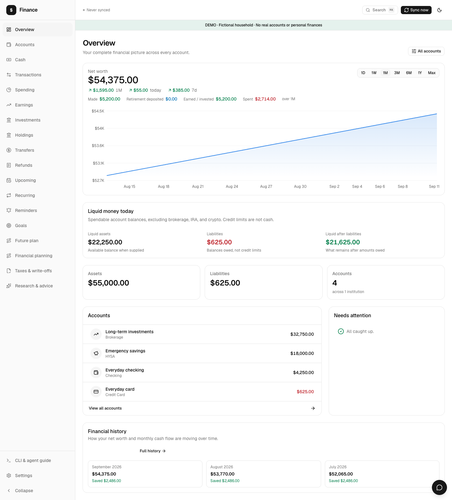

The landing page answers "where do I stand" in one screen: net worth across
every included account, the trend line over a range you pick, day/week/month
deltas, and this month's earned-versus-spent. Accounts can be toggled in and
out of the total, so a shared card or an account you do not think of as yours
can be excluded without deleting it.

### Spending — where it actually went

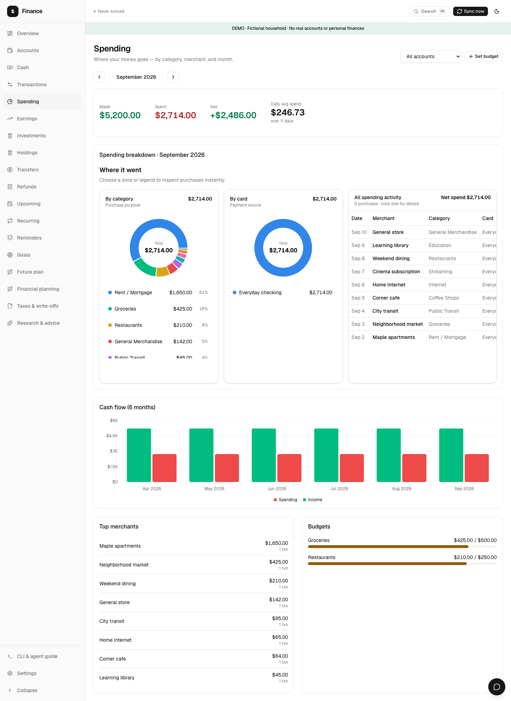

Category breakdown and top merchants for any month, with budgets checked
against actuals. Refunds are netted against the category they reverse rather
than counted as income, and transfers between your own accounts are excluded
from both sides — the two mistakes that make most spending reports wrong.

### Accounts — the whole picture, including the awkward ones

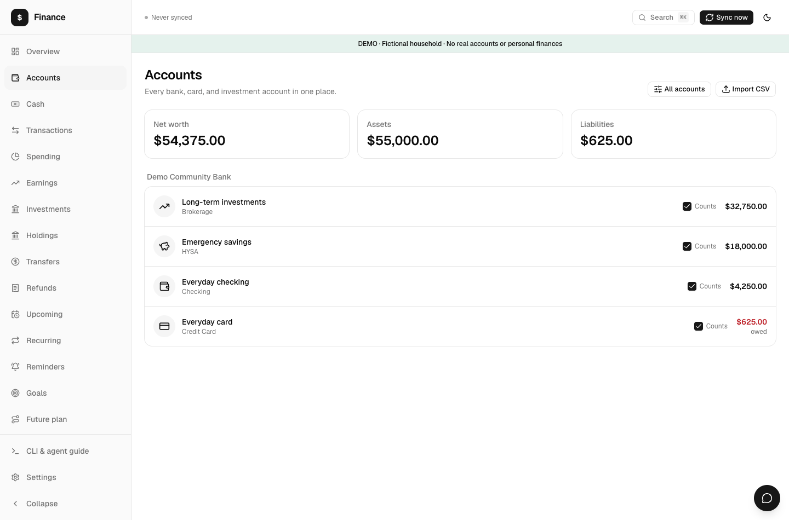

Every account grouped by institution and type, with what is owed marked as
owed and assets and liabilities totalled separately. Any account can be
filtered out of the totals or deactivated. This is also where CSV import lives,
for backfilling history further than a sync provider will reach.

### Holdings — what the investment accounts actually own

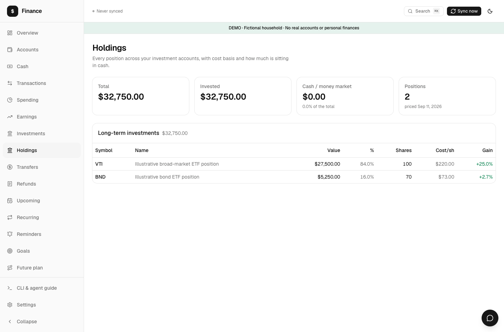

Positions per investment account with cost basis, gain, portfolio weight and
how much is parked in cash or a money market fund. A balance is not a
portfolio; this page is the difference. `fin holdings` adds a concentration
warning when one symbol is 20% or more of the total.

### Upcoming — bills due and what they do to your cash

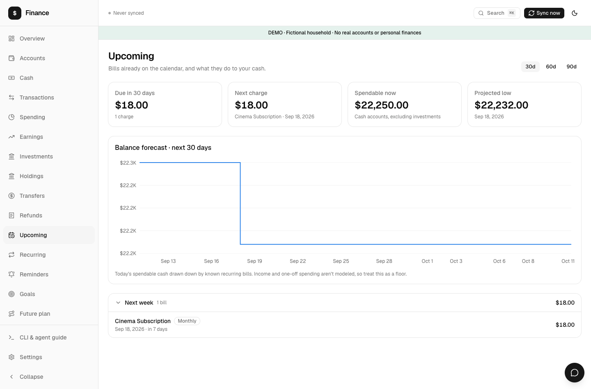

Detected recurring charges projected forward over 30, 60 or 90 days, with a
balance forecast and a low-balance warning. Recurring detection also surfaces
price increases, missed charges and trials about to end, and you can set a
cancellation reminder against any of them.

### Financial planning — give every dollar a job

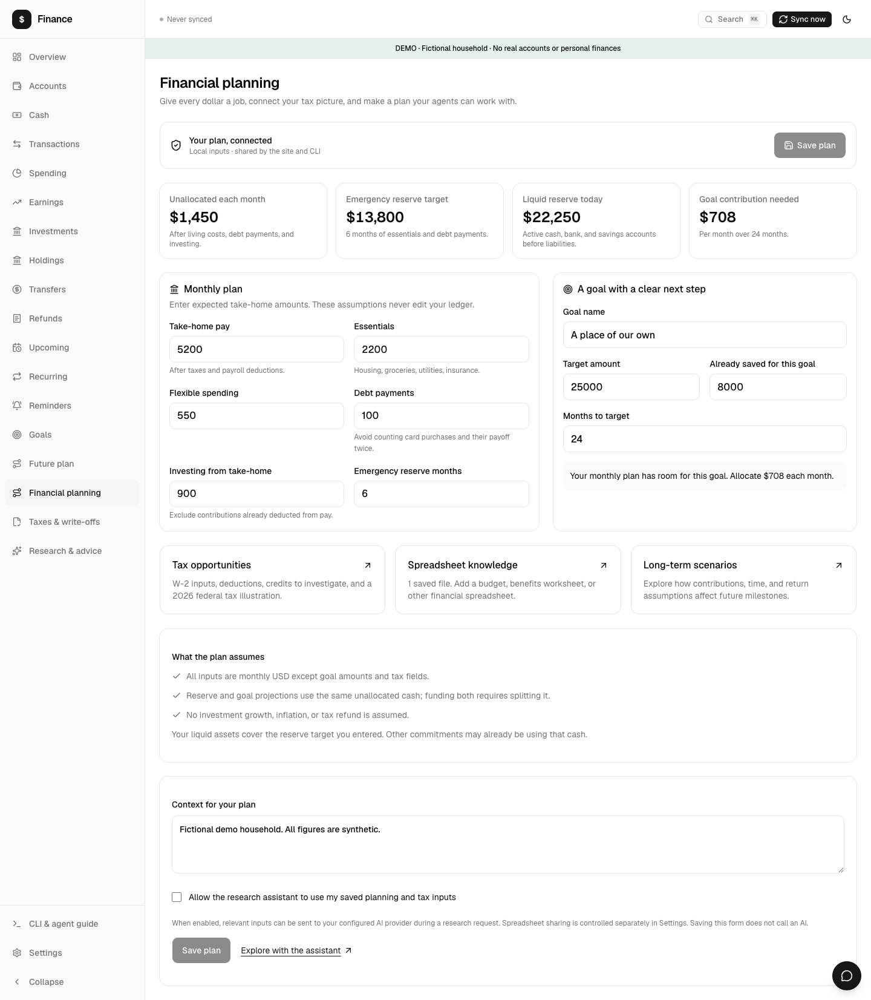

Take-home, essentials, flexible spending, debt payments and investing, turned
into an unallocated-per-month figure, an emergency reserve target measured
against your actual liquid assets, and the monthly contribution a dated goal
requires. These are assumptions you own — saving them never edits your
ledger, and the CLI reads the same profile.

### Taxes — a bounded federal illustration

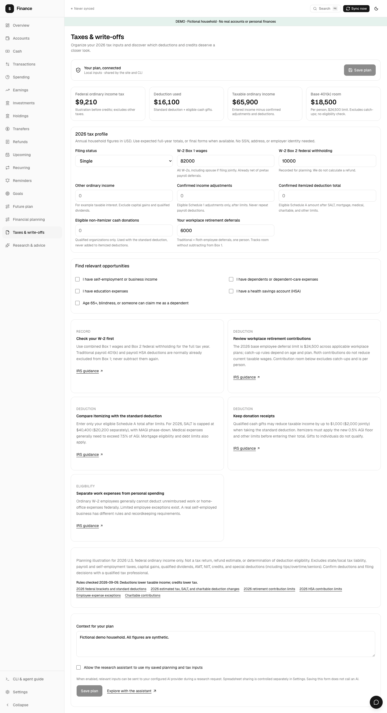

Enter W-2 Box 1 and Box 2, retirement contributions and a few flags, and the
worksheet computes an ordinary-income federal estimate against the 2026
brackets and standard deduction, plus a list of opportunities to check, each
linked to the relevant IRS page. It is deliberately narrow: it excludes state
tax, payroll and self-employment tax, capital gains, AMT, NIIT and credits,
and it says so on the page. It is a planning illustration, not a return.

### Research assistant — evidence, not vibes

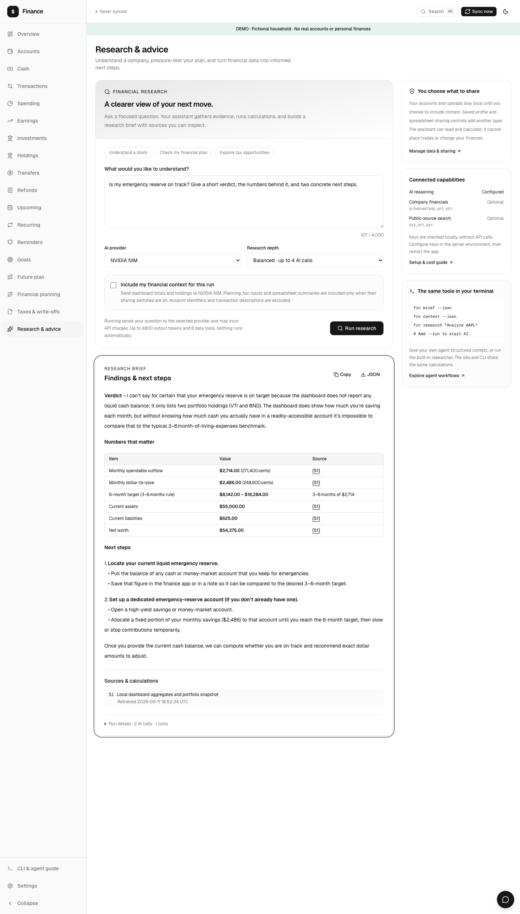

Ask about a company or pressure-test your own plan. The assistant works
through a bounded tool loop — market data, SEC and IRS source search, a local
DCF scenario calculator, and, only if you opt in per run, your own aggregate
figures. Answers cite numbered sources you can click, and the run reports its
provider, model, model calls, tool calls and token usage. When no evidence was
retrieved the run says so in place of an answer, and the system prompt tells
the model to name the gap rather than assert a financial conclusion.

### CLI & agent guide — built into the app

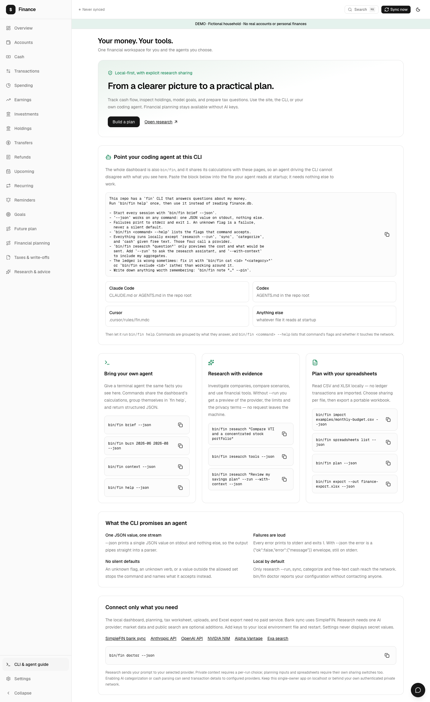

An in-app page with copyable commands for the three workflows the CLI is
built around: hand your own agent the same facts you see on screen, research
with evidence, and plan with your own spreadsheets. It also lists which
services each feature needs and links to where you get a key.

### Settings — spreadsheets in, XLSX out

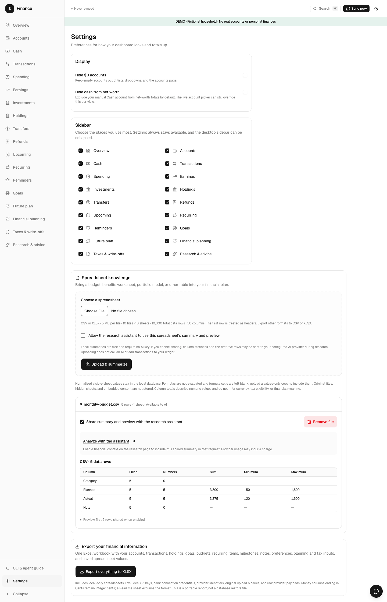

Display preferences, which sidebar destinations you want, and the data
controls: upload a CSV or XLSX budget to be summarised locally, choose
per-file whether the research assistant may read it, and export the whole
ledger to a workbook. Settings never displays secret values.

### Dark mode

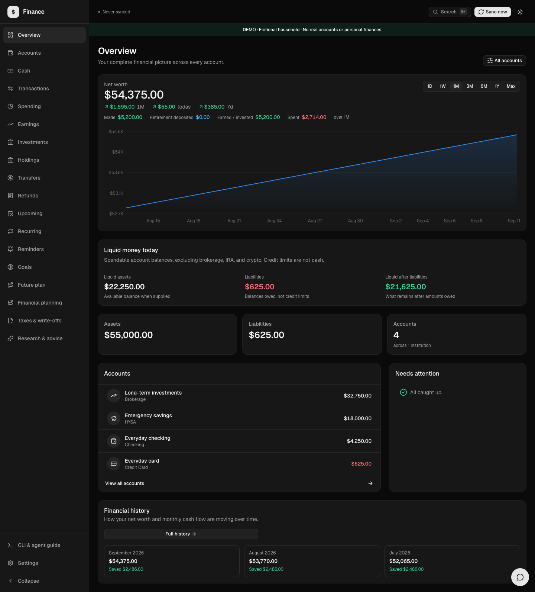

The whole app follows the system theme, with a manual override.

---

## The `fin` CLI

`bin/fin` is the dashboard's whole feature set as terminal commands. It shares
`src/lib/` with the web app, so the two apply the same rules to the same
database. For most questions it is the faster and cheaper way in — no dev
server, no clicking.

Start a session with `fin brief`. It is designed to fit in about 300 tokens:
balances, three months of burn, this month's top categories, and every note
you pinned.

```
$ fin brief
finance — 2026-09-11

  Net worth      $54,375.00  (day +$55.00, week +$385.00, month +$1,595.00)
  Spendable      $22,250.00   card debt $625.00
  Last 3 months  earned $15,600.00 · net spent $8,142.00 · burn 52.2%
  MONTH       EARNED  NET SPENT      SAVED   BURN
  2026-07  $5,200.00  $2,714.00  $2,486.00  52.2%
  2026-08  $5,200.00  $2,714.00  $2,486.00  52.2%
  2026-09  $5,200.00  $2,714.00  $2,486.00  52.2%
  Top 2026-09: Rent / Mortgage $1,650 · Groceries $425 · Restaurants $210 · General Merchandise $142

Context
  (none yet — add one with: fin note "…" --pin)
```

`fin burn` answers "how much did I actually make, and where did it go" —
including pay that was direct-deposited into a brokerage, which the naive read
loses:

```
$ fin burn 2026-07 2026-09
  MONTH                 EARNED   TAKE-HOME  GROSS OUT  CREDITS  NET SPENT      SAVED   BURN
  2026-07            $5,200.00   $5,200.00  $2,714.00    $0.00  $2,714.00  $2,486.00  52.2%
  2026-08            $5,200.00   $5,200.00  $2,714.00    $0.00  $2,714.00  $2,486.00  52.2%
  2026-09            $5,200.00   $5,200.00  $2,714.00    $0.00  $2,714.00  $2,486.00  52.2%
  2026-07..2026-09  $15,600.00  $15,600.00  $8,142.00    $0.00  $8,142.00  $7,458.00  52.2%

Where it went
  DESTINATION                        AMOUNT  SHARE
  Lived on (net spending)         $8,142.00  52.2%
  Left in cash / paid down cards  $7,458.00  47.8%
```

`fin spending` breaks a month down by category, merchant or card:

```
$ fin spending 2026-09 --by category
  Made   $5,200.00
  Spent  $2,714.00
  Net    +$2,486.00

September 2026 by category
  CATEGORY                 SPENT  SHARE  N
  Rent / Mortgage      $1,650.00  60.8%  1
  Groceries              $425.00  15.7%  1
  Restaurants            $210.00   7.7%  1
  General Merchandise    $142.00   5.2%  1
  Public Transit          $95.00   3.5%  1
  Internet                $65.00   2.4%  1
  Coffee Shops            $64.00   2.4%  1
  Education               $45.00   1.7%  1
  Streaming               $18.00   0.7%  1
```

`fin allowance` turns a monthly budget into a number you can act on today,
after subtracting bills already committed for the rest of the month. The
budget is the sum of your budget groups when any exist (`fin budgets set Food
500 --categories "Groceries,Restaurants"`, `fin budgets set Everything 2500
--catch-all`, `fin budgets rm Food`; the output then adds a per-group block);
otherwise the older single number, `fin config monthly_budget_cents 300000` for
the $3,000 below. With neither set the command says so and stops:

```
$ fin allowance

Allowance — 2026-09
  Budget           $3,000.00
  Spent            $2,714.00  (day 11 of 30)
  Committed bills  $18.00
  Free to spend    $268.00
  Per day          $14.10  over 19 days
  Current pace     $246.73/day → $7,401.90
```

Every command takes `--json`, and money is integer cents in JSON:

```
$ fin allowance --json
{
  "monthKey": "2026-09",
  "budgetCents": 300000,
  "spentCents": 271400,
  "committedCents": 1800,
  "remainingCents": 28600,
  "freeCents": 26800,
  "daysInMonth": 30,
  "daysElapsed": 11,
  "daysRemaining": 19,
  "perDayCents": 1410,
  "paceCents": 24673,
  "projectedCents": 740190,
  "isOver": false
}
```

### Everything it can do

```
$ fin help
fin — personal finance from the terminal

Usage: fin <command> [args] [--json]

Driving this from an agent:
  fin brief --json                                  the state of the money in ~300 tokens
  fin burn / spending / txns / holdings --json      follow whatever the brief raises
  fin research "…" --json                           preview: provider, limits, privacy; no network
  fin research "…" --run --with-context --json      the only step that sends the question out
  fin note "…" --pin                                so the next session starts knowing it

Start here:
  brief           session primer: balances, burn, and saved context [--months N] [--to YYYY-MM]
  context         local aggregate snapshot and planning context, as one JSON object
  doctor          which keys and database are configured; contacts nothing

What happened to the money:
  overview        net worth, spendable cash, and this month's flow [YYYY-MM]
  accounts        balances per account [--all to include zero balances]
  burn            what you truly earned, spent, and saved [FROM] [TO] [--explain] [--kind K]
  spending        spending for a range: made / spent / net, burn rate, daily average, projected [YYYY-MM] [--period this-month|last-month|ytd|12m|all | --from D --to D] [--by category|merchant|card|month] [--limit N]
  txns            search transactions [TEXT] [--from D] [--to D] [--month M] [--category NAME|ID] [--merchant TEXT] [--account ID] [--kind income|expense|cashflow|transfer] [--source INCOME_SOURCE] [--limit N]; same filter as /transactions
  earnings        income sources for a month [YYYY-MM]
  investments     invested balances, plus contributions / deposits / dividends & interest / moved out / fees for a range, as /investments shows them [--period P | --from D --to D] (default ytd)
  holdings        what each investment account actually holds [--account ID] [--symbol NVDA]
  transfers       money moved between your own accounts [--limit N]
  refunds         refunds and what they reverse [--limit N]
  trend           income vs spending by month [--months N]
  history         net worth and savings per period [--period month|week] [--limit N]
  allowance       what you can spend per day for the rest of the month; sums budget groups when set [--month YYYY-MM]
  cash            physical cash: `fin cash`, `fin cash add 40 tips`, `fin cash set 500` [--limit N]
  income          pay per job: W-2 / self-employment / nontaxable, owed and unmatched deposits [YEAR] [--source NAME]; any range: `--from YYYY-MM[-DD] --to … [--by week|month|quarter|year] [--basis paid|work] [--source A,B,Other]`; `log SOURCE --month YYYY-MM --hours N [--amount X] [--paid YYYY-MM-DD] [--txn ID]`; `earnings [--from D] [--to D]` for the Earnings tab
  activity        investment history: what was bought/sold/paid in, when, and with what money [--account ID] [--symbol X] [--kind buy|sell|dividend|interest|contribution|transfer-in|transfer-out|fee|other] [--from YYYY-MM[-DD]] [--to …] [--all] [--limit N]
  points          loyalty balances and estimated value; `fin points set NAME BALANCE [--kind card|airline|hotel|other] [--cpp 1.1]`
  trips           booked and past trips, nights per program this year [--upcoming]; `fin trips add --kind flight|hotel|car|other --provider P --title T --start YYYY-MM-DD [--end D] [--cost X] [--program NAME] [--via V]`
  cards           credit cards, rates, fees, what to use each for; `fin cards set NAME [--base 3] [--rate dining=3,drugstores=3] [--fee 0] [--fx 3|unknown] [--account ID|none] [--issuer T] [--currency cash|"chase ur"] [--active yes|no] [--note T]`; `fin cards remove NAME`; `fin cards missed [--from YYYY-MM] [--to YYYY-MM]`

What is coming:
  upcoming        bills due and the balance forecast [--days N]
  recurring       recurring charges, their cadence, and trials ending
  reminders       cancellation reminders: `list`, `add NAME YYYY-MM-DD`, `done ID` [--all]
  goals           goal progress, free cash flow, and debts
  anomalies       unusual spending this month [--month YYYY-MM]

Planning inputs and files:
  budgets         budget groups vs actuals, pace and per-day left [YYYY-MM] · set NAME AMOUNT --categories "A,B" | --catch-all · rm NAME
  plan            financial plan [show|schema|set --file PROFILE.json] [--for-agent]
  points-vs-cash  should this booking use points? `fin points-vs-cash 104 9436 --program chase [--hotel wyndham [--direct PRICE] [--stays N]]`
  business        Schedule C expenses and SEP room [YEAR]; `fin business add "ITEM" --amount 249.99|unknown [--date D] [--paid-with T] [--pct 0-100] [--category C] [--txn ID] [--note T] [--year Y]`
  sep             SEP IRA max, SE tax, and Solo 401(k) alternative [YEAR] [--w2-deferrals DOLLARS]
  card-for        which card for this purchase? `fin card-for Restaurants|MERCHANT [--abroad] [--amount 40] [--date YYYY-MM-DD]`
  take-home       2026 after tax: W-2 gross rebuilt from paychecks, federal/FICA/SE/CA tax, set-aside, where the money went [YEAR] [--w2-gross X]; `set [--salary X] [--full-time YYYY-MM-DD] [--k401 pretax|roth] [--k401-pct N] [--hsa-payroll yes|no] [--periods N] [--ca-allowances N] [--project yes|no] [--ytd-gross X --as-of YYYY-MM-DD] [--deferrals X] [--fed-withheld X] [--ca-withheld X] [--expected-se X]` (none clears)
  taxes           tax opportunities [show|schema|set --file TAX.json]
  import          read a planning spreadsheet PATH.csv|xlsx; imports no transactions [--share-with-agent]
  spreadsheets    planning uploads [list|share ID|unshare ID|remove ID] [--for-agent]
  export          export finance data to XLSX --out PATH.xlsx [--force]; with --month YYYY-MM, one month with splits and the audit log

Correcting the ledger:
  cat             fix a category and remember it: `fin cat 412 "Public Transit"`
  exclude         drop a row from every total, keeping it visible: `fin exclude 410` [--undo]
  refund-mark     flag money-in as a refund: `fin refund-mark 400 --reverses 222` [--undo]
  split           count only your share of a shared purchase: `fin split 412 21.00` [--undo]
  changes         audit log of assistant and split edits [--month YYYY-MM]; every proposal/apply/undo/discard with the exact command: [--all [--limit N]]
  pending         pending holds, and which already settled twice [--days N]
  note            remember something: `fin note "…" --pin --kind fact|decision|todo|question`

Research (asks an AI provider, and only with --run):
  research        research QUESTION [--run] [--with-context] [--provider anthropic|openai|nim] [--steps 2-6]; also status|tools|schema

Setup and escape hatches:
  auth            web sign-in: `status` (this shell's env) or `revoke` to sign out every web session
  sync            pull fresh data from SimpleFIN [--full also re-detects and categorises]
  categorize      categorise uncategorised transactions [--limit N]
  config          read or write settings: `fin config` lists, `fin config KEY` reads one, `fin config KEY VALUE` writes
  sql             read-only SQL escape hatch: `fin sql "select …"`

  Everything is local except `research --run`, `sync`, `categorize`, and `cash` given free
  text — those four call a provider. `fin doctor` checks configuration without contacting one.
  Reporting commands only read, with two exceptions: `brief` and `overview` refresh today's
  balance snapshot. `fin <command> --help` states the network and the writes for that command.
  --json prints one JSON value on stdout and nothing else; failures print to stderr and exit 1.
  --help on any command lists the flags it accepts. Any [YYYY-MM] positional also accepts --month.
```

### Newer commands, by question

Every page in the web app has a twin here; these arrived with the
range-picker rebuild. Each still takes `--json`, and `fin <command> --help`
lists its flags.

```
# Spending and transactions — the same filters the pages link to
fin spending --period ytd --by month          # this-month|last-month|ytd|12m|all, or --from D --to D
fin spending --from 2026-03-01 --to 2026-03-31 --by card
fin txns --from 2026-10-01 --to 2026-10-31 --category Restaurants --account 4
fin txns --kind income --source "Acme"     # also --merchant TEXT, free TEXT, --limit N
fin budgets 2026-11                           # groups vs actuals, pace, per-day left
fin budgets set Food 500 --categories "Groceries,Restaurants"
fin allowance                                 # sums the groups above when set

# Income
fin income 2026                               # per job: W-2 / self-employment / nontaxable, owed, unmatched
fin income --from 2026-01 --to 2026-06 --by month --basis work --source "Acme,Other"
fin income log "Tutoring" --month 2026-10 --hours 12 --amount 480 --paid 2026-11-03
fin income earnings --from 2026-01-01         # the Earnings tab
fin take-home                                 # 2026 after tax: gross from paychecks, fed/FICA/SE/CA, set-aside
fin take-home set --salary 120000 --k401 pretax --k401-pct 6 --hsa-payroll yes

# Investments
fin activity --symbol VTI --kind buy --from 2026-01   # bought/sold/paid in, and with what money

# Taxes and side business
fin business 2026                             # Schedule C expenses and SEP room
fin business add "Monitor" --amount 249.99 --date 2026-04-02 --pct 80 --category equipment
fin sep 2026 --w2-deferrals 23500             # SEP IRA max, SE tax, Solo 401(k) alternative

# Cards and points
fin cards                                     # rates, fees, what each card is for
fin cards set "Freedom Unlimited" --base 1.5 --rate dining=3,drugstores=3 --fee 0 --account 3
fin cards missed --from 2026-01               # where a better card would have earned more
fin card-for Restaurants --amount 40          # or a merchant name; --abroad weighs FX fees
fin points                                    # balances and estimated value
fin points set "Chase UR" 84000 --kind card --cpp 1.25
fin points-vs-cash 104 9436 --program chase   # cash price, points price
fin points-vs-cash 120 15000 --program wyndham --hotel wyndham --direct 115 --stays 2
fin trips --upcoming
fin trips add --kind hotel --provider Hyatt --title "Austin" --start 2026-12-04 --end 2026-12-07 --cost 540

# Audit and sign-in
fin changes --all --limit 50                  # every proposal/apply/undo/discard with its exact command
fin auth status                               # whether this shell's env enables web sign-in
fin auth revoke                               # sign out every web session
```

Full reference, including the alias table and the JSON contract:
**[docs/cli-reference.md](docs/cli-reference.md)**.

To use it from anywhere — the launcher resolves its own symlinks and pins the
database path, so your working directory never decides which ledger you read:

```bash
ln -s "$PWD/bin/fin" ~/.local/bin/fin
```

---

## Driving it with your own AI agent

This is the part that changes how the app is used. Because almost every screen
has a `--json` command behind it, you can hand the CLI to a coding agent — Claude
Code, Codex, Cursor — and do financial planning as a conversation, against
your real numbers, with the agent you already pay for. No key of the app's own
is needed for this: your agent brings its own model, and `fin` gives it eyes.

Paste this into your agent's context file:

```markdown
This machine has a local personal-finance database and a `fin` CLI that reads
it. `fin` shares its query layer with the web dashboard, so it answers with
the same numbers the dashboard shows. Prefer it over reading the SQLite file
directly.

Start every session about money with `fin brief` — balances, three months of
burn, and every fact previously worth writing down, in about 300 tokens.
`fin help` lists every command; `--json` on any command gives the structured
form. Money is integer cents in JSON and dollars in the tables.

Reading:
  fin brief                          # run this first
  fin overview                       # net worth, spendable cash, month flow
  fin burn 2026-06 2026-08           # true earned / spent / saved
  fin burn --explain --kind income   # why any row landed in a bucket
  fin spending 2026-08 --by merchant
  fin txns amazon --limit 10
  fin holdings                       # positions per investment account
  fin upcoming --days 60             # bills due and the balance forecast
  fin goals                          # goal progress and free cash flow
  fin plan --json                    # saved financial plan and assumptions
  fin taxes --json                   # federal tax illustration
  fin context --json                 # one aggregate snapshot for planning
  fin sql "select …"                 # SQL escape hatch; use SELECT only, never a write

Correcting the ledger — it is wrong sometimes, fix it in place:
  fin cat 412 "Public Transit"       # also writes a rule, so it sticks
  fin exclude 410                    # keep the row, drop it from totals
  fin refund-mark 400 --reverses 222
  fin note "…" --pin                 # so it is never re-derived

Rules that matter:
- Categorising changes totals. A category whose kind is `transfer` removes the
  row from income. Re-run `fin burn` after `fin cat` and say so if the numbers
  moved.
- Two income numbers are both correct. `fin trend`/`spending`/`earnings` show
  cash that landed in spendable accounts — the budgeting view. `fin burn`
  shows everything earned, including pay deposited straight into a brokerage.
  Do not average them; pick the one that answers the question.
- Pending card holds and their settlements arrive as two rows. `fin pending`
  finds the pairs.
- `fin research` costs money and calls a remote API. Never add `--run` unless
  I asked for it in this conversation, and never add `--with-context` unless I
  said to share my figures.
```

### The safety model

Reading is free and local. Four commands touch the network — `sync`,
`categorize`, `research --run`, and `cash` given free text — and the one that
could disclose your figures needs two separate flags, so an agent cannot
stumble into it.

- **Read-only by default.** `brief`, `overview`, `burn`, `spending`, `txns`,
  `holdings`, `upcoming`, `goals`, `allowance`, `context`, `doctor` and the
  rest of the reporting commands answer from the local database and send
  nothing. (`brief` and `overview` also record today's balance snapshot
  locally, which is the only thing any reporting command writes.) `fin sql`
  takes one statement at a time, requires it to begin `SELECT` or `WITH`, and
  runs it under SQLite's `PRAGMA query_only`, so a statement that slips past
  the keyword check — `WITH … INSERT`, for instance — still cannot write.
  Bare `fin config` hides any key whose name matches `token`, `url` or
  `secret`, so credentials never land in a transcript.
- **Local writes are local.** `cat`, `exclude`, `refund-mark`, `note`,
  `plan set`, `import` and friends change your database and transmit nothing.
  `cash` is the exception: given free text it sends that sentence to a
  provider to be parsed, and falls back to a local regex parser if none is
  configured.
- **`--run` gates the network.** `fin research` previews by default: it prints
  the provider that would be used and the ceilings that would apply, and makes
  no request. The request schema requires `allowRemote: true` literally, so
  consent cannot be defaulted in.
- **`--with-context` gates your data.** Without it, the local tools are not
  even created, and the model is told it has no access to your finances. With
  it, the assistant can read aggregate balances, three months of cash flow and
  your positions — but never transaction descriptions, account names or
  account identifiers. Your saved plan and each uploaded spreadsheet need
  their own sharing switch on top of that.
- **One vendor per run.** Categorisation may fall through Anthropic → OpenAI →
  NVIDIA NIM if one is down. A research run does not: it uses the provider you
  chose and fails with a message if that provider is unavailable.

```
$ fin research "Is my six-month emergency reserve the right size?" --with-context
Research preview · no network requests or charges
  Provider               anthropic
  Private context        enabled
  Maximum model calls    4
  Maximum tool calls     8
  Maximum output tokens  4800
  Add --run to send this question to the configured AI provider. Add --with-context only to share dashboard aggregates, holdings and opted-in planning/upload summaries.
```

### Bounded by construction

A research run cannot grow without limit. From `RESEARCH_LIMITS` in
`src/lib/ai/research-types.ts`:

| Limit | Value |
| --- | --- |
| Model calls per run (`--steps`) | 2–6, default 4 |
| Tool calls per run | 8 |
| Output tokens per model call | 1,200 |
| Characters per tool result | 7,000, then truncated |
| Total conversation characters | 42,000, then the run stops and says so |
| Wall clock | 4 minutes; tool steps stop 1 minute early so the last call can summarise what was gathered (answer marked limited) |

Identical tool calls are cached within a run, a tool batch larger than the
remaining budget is refused, and every source URL is filtered to `https` with
no embedded credentials, rejecting localhost and the common private-network
ranges. A run that hits a ceiling reports `limited: true` instead of guessing.

`fin research schema --json` prints the exact request schema;
`fin research tools --json` prints the tools that would be offered. More
detail, including a worked session: **[docs/agents.md](docs/agents.md)**.

---

## Setup

### Prerequisites

- **[Bun](https://bun.sh) 1.3+** — runs the app, the scripts and the CLI.
- **Node.js 20.9+** — required by Next.js 16. Bun uses it for parts of the
  build; you do not need to run anything with it directly.

Verified against Bun 1.3.12 and Node 22.19 on macOS.

### Install and run

```bash
git clone https://github.com/1300Sarthak/fin.git finance   # or your fork
cd finance
bun install

cp .env.example .env.local     # optional — every key in it is optional

bun run db:migrate             # create the schema
bun run db:seed                # 49 categories, 55 starter rules, default goals, config
bun run dev                    # http://127.0.0.1:6767
```

If you are **updating an existing database** rather than creating one, run
`bun run db:migrate` after pulling — nothing migrates automatically at boot, and
a page that needs a new table (`/holdings`, for example) will error until you
do. It is safe to re-run; applied migrations are skipped.

`db:migrate` and `db:seed` print what they did:

```
✓ migrations applied to file:finance.db
✓ categories seeded (49)
✓ goals seeded (emergency fund -> Roth -> taxable)
✓ config defaults ensured (6)
✓ rules seeded (55)
seed complete
```

The seed is idempotent — running it again only fills in what is missing.

### See it populated, without connecting a bank

```bash
bun run demo:seed              # builds .data/demo.db, a fictional household
bun run demo                   # http://127.0.0.1:6768, with a DEMO banner
```

The demo database is entirely separate from `finance.db` and is never read or
overwritten by the real app. Point the CLI at it the same way:

```bash
DATABASE_URL=file:.data/demo.db bun run fin brief
```

`demo:seed` refuses to run if `.data/demo.db` already exists — delete the file
to rebuild it.

### Connect your accounts

**SimpleFIN (recommended).** Read-only by protocol — it can fetch accounts,
transactions and holdings, and nothing else. One bridge subscription covers
up to 25 institutions.

1. Get a setup token at <https://bridge.simplefin.org>.
2. Put it in `.env.local` as `SIMPLEFIN_ACCESS_URL=` — a token or an access
   URL are both accepted there. Setup tokens are single-use; the first sync
   claims yours and caches the resulting access URL locally.
3. `bun run sync`, or click **Sync now** in the app.

If you would rather claim the token explicitly first:

```bash
bun run scripts/claim-token.ts <SETUP_TOKEN>
bun run scripts/claim-token.ts demo    # prints SimpleFIN's public demo access URL
```

**CSV.** SimpleFIN returns roughly 90 days of history. To go further back,
export a CSV from your bank and use **Import CSV** on the Accounts page. The
importer needs a date column and an amount column, and can flip signs for
banks that report them the other way round.

### Scheduled sync

`bun run sync` is a plain script — wire it to `cron`, `launchd`, systemd
timers or whatever you already use. It exits non-zero on failure and prints
what it changed.

### Other scripts

| Command | What it does |
| --- | --- |
| `bun run dev` / `build` / `start` | Dev server, production build, production serve |
| `bun run fin <command>` | The CLI, without installing it on your PATH |
| `bun run sync` | Pull from SimpleFIN |
| `bun run db:migrate` / `db:seed` / `db:reset` | Database lifecycle |
| `bun run db:studio` | Drizzle Studio against your local file |
| `bun run db:wipe` | Drop synced accounts and transactions, keeping categories, goals, config and your SimpleFIN connection |
| `bun run demo:seed` / `demo` | Build and open the fictional demo household |
| `bun test` | 119 tests across 18 files |
| `bun run lint` | ESLint |

---

## API keys

**The app works with no keys at all.** You lose exactly three things: bank
sync, AI categorisation of unfamiliar merchants, and the research assistant.
Everything else — the dashboard, the CLI, planning, taxes, spreadsheet
import, XLSX export — is fully local and needs nothing.

Run `fin doctor` at any time to see what is configured. It reads environment
variables and makes no API calls — here it is with nothing set, pointed at the
demo database:

```
$ fin doctor
Research setup · checked locally, no API calls
  Database       .data/demo.db
  Anthropic      optional key missing
  OpenAI         optional key missing
  NVIDIA NIM     optional key missing
  Alpha Vantage  optional ALPHAVANTAGE_API_KEY missing
  Exa search     optional EXA_API_KEY missing
  Default AI     none — add an AI provider key

Runs send your question to one selected AI provider. Aggregate dashboard data and holdings are opt-in per run; saved planning/tax inputs and spreadsheets additionally require their sharing switches. Nothing is sent by this status check.
  AI: ANTHROPIC_API_KEY / OPENAI_API_KEY / NVIDIA_API_KEY. Optional models: ANTHROPIC_MODEL / OPENAI_MODEL / NIM_MODEL; NIM research and the assistant use ASSISTANT_MODEL.
  Without --run, fin research only prints what a run would cost and send.
  Examples: fin research "Compare AAPL and MSFT cash flow" --json
            fin research "Review my reserve plan" --run --with-context --json
            fin research tools --json; fin research schema --json; fin context --json
```

| Variable | Unlocks | Where to get one | Required? |
| --- | --- | --- | --- |
| `SIMPLEFIN_ACCESS_URL` | Read-only bank, card and brokerage sync, including holdings | [bridge.simplefin.org](https://bridge.simplefin.org) | No — CSV import and manual accounts work instead |
| `ANTHROPIC_API_KEY` | AI categorisation, the cash box, the research assistant | [console.anthropic.com/settings/keys](https://console.anthropic.com/settings/keys) | No — rules and the merchant cache still categorise |
| `OPENAI_API_KEY` | The same three, as a fallback or an alternative | [platform.openai.com/api-keys](https://platform.openai.com/api-keys) | No |
| `NVIDIA_API_KEY` | The same three, as a further fallback | [build.nvidia.com](https://build.nvidia.com) | No |
| `ALPHAVANTAGE_API_KEY` | The research assistant's `stock_data` tool: quotes, company overviews, statements, earnings, news, insider trades | [alphavantage.co/support/#api-key](https://www.alphavantage.co/support/#api-key) | No — the assistant works without it, with fewer tools |
| `EXA_API_KEY` | The research assistant's public-source search, restricted to `sec.gov` for filings and `irs.gov` for tax topics | [dashboard.exa.ai/api-keys](https://dashboard.exa.ai/api-keys) | No |
| `DATABASE_URL` | Which database file to use | — | Defaults to `file:finance.db` |
| `FIN_PASSWORD_HASH` | Web sign-in. Output of `bun run scripts/hash-password.ts` | — | Unset: only loopback requests are served (dev) |
| `FIN_SESSION_SECRET` | Signs session cookies; 32+ random characters. Changing it signs everyone out | `openssl rand -base64 48` | Yes, when `FIN_PASSWORD_HASH` is set |
| `FIN_COOKIE_SECURE` | `1` forces the Secure cookie flag (TLS proxy in front, plain HTTP to the app), `0` forbids it | — | No — inferred from the request |
| `FIN_ALLOW_NO_AUTH` | `loopback` lets a production build run without a password, loopback requests only | — | No |
| `FIN_PRIVATE_NAMES` | Extra names (comma separated) the assistant pseudonymises before anything reaches a model, e.g. family members | — | No |

Model overrides, all optional: `ANTHROPIC_MODEL` (default
`claude-haiku-4-5`), `OPENAI_MODEL` (default `gpt-4o-mini`), `NIM_MODEL`
(default `openai/gpt-oss-20b`) and `NIM_BASE_URL` (default
`https://integrate.api.nvidia.com/v1`). Research on NIM and the
money assistant both use `ASSISTANT_MODEL` (default
`nvidia/nemotron-3-ultra-550b-a55b`); `NIM_MODEL` covers categorising and the
cash box. `NIM_API_KEY` and `EXASEARCH_API_KEY`
are accepted as aliases of `NVIDIA_API_KEY` and `EXA_API_KEY`.

Every variable is documented inline in [`.env.example`](.env.example).

---

## What it costs, and whether that is worth it

### The services

Prices verified against each provider's public pricing page in September 2026.
Check them yourself before relying on them — they change.

| Service | Free tier | Paid pricing | Realistic cost for one person |
| --- | --- | --- | --- |
| **SimpleFIN Bridge** | None | $1.50 + tax per month, or $15 + tax per year. Up to 25 institutions and 25 apps | **$1.50/mo**, or $1.25/mo billed yearly |
| **Anthropic** (default `claude-haiku-4-5`) | None; pay as you go | $1.00 per million input tokens, $5.00 per million output | **Under $0.25/mo** for categorisation; a few cents per research run |
| **OpenAI** (default `gpt-4o-mini`) | None; pay as you go | $0.15 per million input, $0.60 per million output | Pennies, if used instead of Anthropic |
| **NVIDIA NIM** | Free through the NVIDIA Developer Program | — | **$0**, subject to per-model rate limits NVIDIA does not publish |
| **Alpha Vantage** | 25 requests/day | From $49.99/mo | **$0** — the free tier is ample for a personal research habit |
| **Exa** | $10 in credits monthly ($20 on signup) | $7 per 1,000 searches, plus $1 per 1,000 page contents | **$0** — the monthly credit covers hundreds of runs |

A note on the free option: NVIDIA NIM costs nothing, but in testing it was
the least reliable of the three. Some runs return no answer at all, and the
assistant correctly refuses rather than guessing — which is the right
behaviour, but it means retries. If the research assistant is the reason you
are here, an Anthropic or OpenAI key is worth its few cents a month.

### Where AI spend actually comes from

Two places, and both are bounded by design.

**Categorisation is per uncategorised transaction, and cached forever.** Rules
and the merchant cache run first; only merchants that miss both reach a model.
Those are batched 40 at a time, and each batch sends one short line per
transaction (merchant, memo, signed amount) plus the category list — a request
on the order of a thousand tokens in and a thousand out. At Haiku 4.5's rates
that is roughly half a cent per batch of 40, so about **$0.05 to classify 400
freshly imported transactions**. Every answer is written to the merchant
cache, and every manual correction writes a rule, so the same merchant is
never sent twice. Steady state after the first import is a handful of new
merchants a month — pennies. (These are estimates from the batch size and the
published per-token prices, not a measured bill.)

**A research run is per run, and hard-capped.** The default is 4 model calls
at 1,200 output tokens each, 8 tool calls, and 42,000 characters of total
context. The absolute worst case at Haiku 4.5's rates — every step running to
the full context ceiling — is a few cents; a typical run is well under that.
Swapping in a frontier model multiplies it by that model's price ratio, which
is the one way to make this expensive. Tool calls add the Alpha Vantage and
Exa costs above, both of which are free at personal volume.

### Realistic monthly totals

| Configuration | Per month |
| --- | --- |
| Nothing configured — CSV import, manual accounts, planning, taxes, export | **$0.00** |
| SimpleFIN only — automatic sync, rule and cache categorisation | **~$1.50** |
| SimpleFIN + Anthropic — plus AI categorisation and occasional research | **~$1.75** |
| Everything, with a heavy research habit | **$2–5** |

### Is it worth it?

Honestly: **it depends entirely on whether you would run it.**

**It is a good fit if** you already keep some kind of spreadsheet and are
tired of it; you have accounts at institutions that a mainstream aggregator
misses; you object to a company holding your transaction history; you live in
a terminal and want your finances there; or you have a coding agent and want
to point it at real numbers instead of hypotheticals. At $15 a year for the
only component that is not free, it is very hard to beat on cost.

**It is a bad fit if** you want an app on your phone with push notifications;
you want somebody to call when a sync breaks; you want investment advice,
tax filing, or bill negotiation; or you do not want to run `bun install` and
occasionally read an error message. This is a self-hosted tool. Nobody is on
call, and when a bank changes its export format, fixing it is your afternoon.

**The cheapest useful configuration is SimpleFIN and nothing else — $1.50 a
month.** You get automatic sync across every account, and rules plus the
merchant cache categorise the overwhelming majority of transactions with no
AI at all. Add an Anthropic key later if the uncategorised tail annoys you;
it will cost you cents. And if you would rather pay nothing, CSV import plus
the planning and tax workspaces is a genuinely complete offline tool — the
demo household above runs on exactly zero keys.

What you should **not** do is add every key on this page because they are
listed. Add SimpleFIN. Use it for a month. Add the rest only when you have
felt the specific thing they fix.

---

## Privacy and data flow

Full detail, with the source file behind every claim, is in
**[docs/privacy.md](docs/privacy.md)**. The summary:

**With no keys configured, nothing leaves your machine.** Four things can send
data out, and each is one you switched on.

| Trigger | Destination | Payload |
| --- | --- | --- |
| `fin sync` / **Sync now** | Your SimpleFIN access URL | A request for your data. Nothing of yours is uploaded. |
| Categorising an unknown merchant | Your first configured AI provider | Merchant string, memo, signed amount, your note, a local row id — batched 40 at a time. No dates, accounts, balances or identity. |
| The natural-language cash box | Your first configured AI provider | The sentence you typed. Falls back to a local regex parser if no provider is set. |
| The money assistant (/assistant) | The one provider you selected | Pseudonymised: account names and masks become `⟦acct:id⟧`, people `⟦person:N⟧`, emails/phones/codes `⟦ref:N⟧`; row lists keep ids, dates, amounts and a normalised merchant, never memos or notes. Answers are rehydrated locally; the token map is never stored or sent. "What was sent" shows the exact payload. |
| `fin research … --run` | The one provider you selected; plus Alpha Vantage (a ticker) and Exa (a fixed template query) if the model calls those tools | Your question. Your figures only if you also passed `--with-context`. |

**With `--with-context`, the assistant additionally receives:** assets,
liabilities and net worth as totals; three months of income, spending and
saved; the burn report; and up to 50 positions as symbol, shares, market
value, cost basis and as-of date. Your saved plan and each uploaded
spreadsheet are included only if you turned on their own sharing switches.

**Never sent to an AI provider, in any configuration:** your SimpleFIN access
URL or any API key, transaction dates, account names, account identifiers,
institution names, or individual account balances. Each key goes only to the
service it authenticates — the Alpha Vantage key to alphavantage.co, the Exa
key to api.exa.ai — and never anywhere else. The one exception on descriptions
is categorisation, which sends the merchant string, memo and your note for a
row it has not seen before, and nothing else about that row. Spreadsheet cells and profile
text are treated as untrusted data, and the system prompt instructs the model
to ignore instructions embedded in them.

Next.js itself collects anonymous framework telemetry, which carries no
financial data. Turn it off with `bunx next telemetry --disable`.

This is a single-owner app. Set `FIN_PASSWORD_HASH` and `FIN_SESSION_SECRET`
to require a password on the web app (`fin auth status` checks the shell's
env, `fin auth revoke` signs every session out); without them it serves only
loopback requests. Keep it on `localhost` or behind your own private network
either way.

The assistant and the CLI share one tool table: chat reads and proposes writes
only through `fin` commands, read from `fin help --json`. A write command is
proposable when its `writes` text names its verbs —
``local database — with `set` or `rm`; the bare report only reads`` — and anything the parser
cannot read is refused in chat. Applied proposals are logged in `fin changes --all`.

---

## Architecture

```
SimpleFIN / CSV ─► ingest adapters ─► normalize ─► Drizzle upsert ─► finance.db (libSQL)
                                                        │
                              rules → merchant cache → AI categorizer
                                                        │
                                   ┌────────────────────┴────────────────────┐
                              src/lib/  (queries, burn, spending, planning, taxes)
                                   ├────────────────────┬────────────────────┤
                          Next.js App Router                        bin/fin CLI
```

- **Next.js 16, App Router**, React 19, Tailwind v4, Recharts. Pages are
  server components that call `src/lib/` directly; only the interactive parts
  are client components.
- **`src/lib/` is the contract.** Every calculation lives there and is called
  by both surfaces. CLI handlers in `cli/commands/` take `(args, json)` and do
  nothing but format. This is why a fix to a money calculation lands in the
  terminal and the browser at the same time, instead of in one of them.
- **Drizzle ORM over libSQL**, one SQLite file, 17 tables, migrations in
  `drizzle/`. No connection pool, no external database, no ORM magic in the
  route handlers.
- **AI is provider-neutral.** `src/lib/ai/providers.ts` translates one
  internal message shape into Anthropic and OpenAI-compatible wire formats,
  and orders the fallback chain. Adding a provider is one adapter.
- **`bun test`** — 119 tests across 18 files, covering the money maths: burn,
  net worth, planner, recurring detection, refunds, transfers, month
  bucketing, the research loop, the spreadsheet parser, the cash phrase
  parser, and the CLI's argument and flag validation. Pure logic lives in
  `*-core.ts` modules so it can be tested without a database.

Layout:

```
src/app/        routes and API handlers
src/components/ UI
src/lib/        all query and calculation logic — shared with the CLI
src/lib/ai/     provider adapters, the research loop, its tools
src/lib/ingest/ SimpleFIN client, CSV parser, idempotent upsert adapter
src/db/         Drizzle schema, migrate, seed
cli/            fin.ts, commands/, render.ts
scripts/        sync, claim-token, demo seed, maintenance
docs/           this documentation
```

---

## Contributing, license, disclaimer

Contributions are welcome — see [CONTRIBUTING.md](CONTRIBUTING.md). Develop
against the demo database, keep query logic in `src/lib/`, and add a test for
anything that computes money.

Licensed under the [MIT License](LICENSE).

### Disclaimer

**This software is not financial, investment, or tax advice.** It is a tool
for organising your own data and it can be wrong — because a provider sent bad
data, because a category was misassigned, or because of a bug. Check anything
that matters against your actual statements.

The tax feature is a **simplified 2026 U.S. federal ordinary-income
illustration**. It is not a tax return, a refund estimate, or a determination
of deduction eligibility. It excludes state and local tax, payroll and
self-employment tax, capital gains, qualified dividends, AMT, NIIT, credits,
and special deductions. Confirm anything you act on with a qualified tax
professional.

The research assistant produces model-generated analysis from public sources.
Verify every figure and citation before acting on it. A DCF scenario is an
assumption-driven illustration, not a price prediction.
